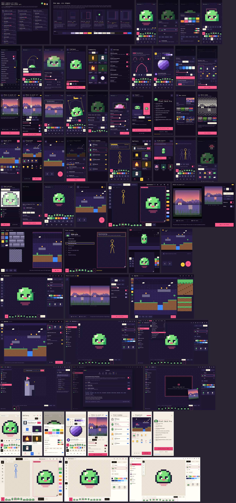

# Pixel Deck v2 design

The v2 design for every platform: iPhone, iPhone Duo (closed, open flat, half open and tabletop), iPad and Mac, in Night (dark) and Paper (light).
Feature numbers match [`Notes/v2-core-features.md`](../../Notes/v2-core-features.md). Colours match `PixelDeck/Support/Theme.swift`.

Live, editable canvas: https://claude.ai/artifact/HDBtGLha8TMBWr3y2NpzrX (sections 4 to 13 are v2; 1 to 3 are the first concept from 14 Nov).

## What is here

- `screens/`: every screen rendered at 2x, grouped by section. Start here.
- `source/`: the design files from the canvas (`.dc.html` artboards and `canvas.json`). They are HTML with inline styles, so exact sizes, spacing and colours can be read straight from them. `Sprite.dc.html` holds the sprite renderer.
- `assets/`: the artwork the screens use, all original: the sample photo and its pixel-art conversions, retro modes, the tileset and Playground level, shading and stroke examples, the bead pattern, stamps. `generate_assets.py` recreates them (Python 3 + Pillow) and `sprites.json` holds the starter sprites.

## Decisions made in the design (not yet agreed)

- Release grouping: v2.0 Make complex art easy (1, 2, 3, 4, 7, 8, 9, 15, 18, 19), v2.1 From pixels to play (10, 11, 12, 13, 14), v2.2 Beyond the canvas (5, 6, 16, 17, 20).
- Free and Pro split for items the notes did not price, and a 7-day Pro trial on the paywall (from the growth section of `Notes/v2-ideas.md`). `[PRICE]` is a placeholder.
- iPhone Duo sizes are design points: one third of Apple's screenshot pixels (closed 466 x 678, open 951 x 669 and 669 x 951).
- AI assistants on the Mac (item 20) are off by default; each assistant app is approved in Settings, every action is one undo step, and a banner with Stop shows while one draws.

## Screens

### The plan and the platforms

- [v2 · The plan: 20 features in three releases](screens/01-plan/01-v2-plan.png) · 1500 x 1340
- [Platforms: iPhone, iPhone Duo, iPad, Mac](screens/01-plan/02-v2-platforms.png) · 1700 x 900

### iPhone today (v1.1 as built)

- [Studio · brush strip, layer chip](screens/02-iphone-today/01-v1-studio.png) · 390 x 844
- [Layers · up to 8, shared by every frame](screens/02-iphone-today/02-v1-layers.png) · 390 x 844
- [Colours · my palettes, ready-made, import](screens/02-iphone-today/03-v1-colours.png) · 390 x 844
- [Shapes · 10 shapes, outline or filled, 1:1](screens/02-iphone-today/04-v1-shapes.png) · 390 x 844
- [Sprite menu](screens/02-iphone-today/05-v1-sprite-menu.png) · 390 x 844
- [Motion tweening along a path](screens/02-iphone-today/06-v1-tween.png) · 390 x 844
- [Tracing image](screens/02-iphone-today/07-v1-tracing.png) · 390 x 844
- [Timelapse](screens/02-iphone-today/08-v1-timelapse.png) · 390 x 844
- [Community · Popular, hearts](screens/02-iphone-today/09-v1-community.png) · 390 x 844
- [Settings](screens/02-iphone-today/10-v1-settings.png) · 390 x 844

### v2.0 · Make complex art easy (iPhone)

- [01 · Pixel-perfect strokes](screens/03-v2.0-iphone/01-v2-pixel-perfect.png) · 390 x 844
- [02 · Shading assistant](screens/03-v2.0-iphone/02-v2-shading.png) · 390 x 844
- [03 · Smart palettes: ramps and a colour hint](screens/03-v2.0-iphone/03-v2-smart-palettes.png) · 390 x 844
- [04 · One-tap animation presets](screens/03-v2.0-iphone/04-v2-presets.png) · 390 x 844
- [07 · Photo to pixel art · choose](screens/03-v2.0-iphone/05-v2-photo-choose.png) · 390 x 844
- [07 · Photo to pixel art · adjust](screens/03-v2.0-iphone/06-v2-photo-adjust.png) · 390 x 844
- [07 · Photo to pixel art · in the Studio](screens/03-v2.0-iphone/07-v2-photo-studio.png) · 390 x 844
- [08 · Lasso, wand, rotate and scale](screens/03-v2.0-iphone/08-v2-selection.png) · 390 x 844
- [09 · Onion skin 2 back + next, holds, ping-pong](screens/03-v2.0-iphone/09-v2-onion-timing.png) · 390 x 844
- [19 · Adjust colours of selected pixels](screens/03-v2.0-iphone/10-v2-adjust-colours.png) · 390 x 844
- [15 · Share-ready 9:16 video with end card](screens/03-v2.0-iphone/11-v2-share-video.png) · 390 x 844
- [15 · Pro, with a free 7-day trial](screens/03-v2.0-iphone/12-v2-paywall.png) · 390 x 844

### v2.1 · From pixels to play (iPhone)

- [New canvas · blank, photo, retro, tiles, level](screens/04-v2.1-iphone/01-v2-new-canvas.png) · 390 x 844
- [12 · Retro modes](screens/04-v2.1-iphone/02-v2-retro-modes.png) · 390 x 844
- [10 · Tiles and scene builder](screens/04-v2.1-iphone/03-v2-tiles.png) · 390 x 844
- [11 · Pixel Playground · edit](screens/04-v2.1-iphone/04-v2-playground-edit.png) · 390 x 844
- [11 · Pixel Playground · play](screens/04-v2.1-iphone/05-v2-playground-play.png) · 390 x 844
- [11 · Pixel Playground · share](screens/04-v2.1-iphone/06-v2-playground-share.png) · 390 x 844
- [13 · Pixel Academy · lessons](screens/04-v2.1-iphone/07-v2-academy.png) · 390 x 844
- [13 · Pixel Academy · a lesson step](screens/04-v2.1-iphone/08-v2-academy-lesson.png) · 390 x 844
- [14 · Gallery with Idea of the day](screens/04-v2.1-iphone/09-v2-gallery.png) · 390 x 844
- [14 · Remix family tree](screens/04-v2.1-iphone/10-v2-remix-tree.png) · 390 x 844

### v2.2 · Beyond the canvas (iPhone)

- [05 · Motion guides](screens/05-v2.2-iphone/01-v2-motion-guides.png) · 390 x 844
- [06 · Stamps library](screens/05-v2.2-iphone/02-v2-stamps.png) · 390 x 844
- [16 · Bead and cross-stitch patterns](screens/05-v2.2-iphone/03-v2-beads.png) · 390 x 844
- [17 · Aseprite import](screens/05-v2.2-iphone/04-v2-aseprite.png) · 390 x 844

### iPhone Duo · closed, half open and tabletop

- [iPhone Duo · closed · Pocket studio](screens/06-iphone-duo-closed-and-half-open/01-duo-outer-studio.png) · 466 x 678
- [iPhone Duo · closed · Playground](screens/06-iphone-duo-closed-and-half-open/02-duo-outer-play.png) · 466 x 678

### iPhone Duo · open flat

- [iPhone Duo · open flat · Flipbook spread with guides](screens/07-iphone-duo-open-flat/01-duo-wide-spread.png) · 951 x 669
- [iPhone Duo · open flat · Photo to pixel art](screens/07-iphone-duo-open-flat/02-duo-wide-photo.png) · 951 x 669
- [iPhone Duo · open flat · Tile editor and scene](screens/07-iphone-duo-open-flat/03-duo-wide-tiles.png) · 951 x 669
- [iPhone Duo · open flat · Pixel Academy](screens/07-iphone-duo-open-flat/04-duo-wide-academy.png) · 951 x 669

### iPhone Duo · closed, half open and tabletop

- [iPhone Duo · half open · Easel](screens/06-iphone-duo-closed-and-half-open/03-duo-tall-easel.png) · 669 x 951
- [iPhone Duo · tabletop · Playground controller](screens/06-iphone-duo-closed-and-half-open/04-duo-tall-play.png) · 669 x 951

### iPad

- [iPad · Studio with inspector and Pencil hover](screens/08-ipad/01-ipad-studio.png) · 1180 x 820
- [iPad · Photo to pixel art](screens/08-ipad/02-ipad-photo.png) · 1180 x 820
- [iPad · Tiles and scene](screens/08-ipad/03-ipad-tiles.png) · 1180 x 820
- [iPad · Pixel Playground editor](screens/08-ipad/04-ipad-playground.png) · 1180 x 820

### Mac

- [Mac · Studio window](screens/09-mac/01-mac-studio.png) · 1440 x 900
- [Mac · menu bar with every shortcut](screens/09-mac/02-mac-menu.png) · 1440 x 900
- [Mac · 20 · An AI assistant drawing over MCP](screens/09-mac/03-mac-ai.png) · 1440 x 900
- [Mac · 20 · Settings › AI assistants](screens/09-mac/04-mac-ai-settings.png) · 1440 x 900
- [Mac · drag a photo or .aseprite in from Finder](screens/09-mac/05-mac-photo-drop.png) · 1440 x 900

### Paper (light appearance)

- [Paper · Studio](screens/10-paper-light/01-paper-studio.png) · 390 x 844
- [Paper · Gallery with Idea of the day](screens/10-paper-light/02-paper-gallery.png) · 390 x 844
- [Paper · Colours](screens/10-paper-light/03-paper-colours.png) · 390 x 844
- [Paper · Shading assistant](screens/10-paper-light/04-paper-shading.png) · 390 x 844
- [Paper · Photo to pixel art](screens/10-paper-light/05-paper-photo-adjust.png) · 390 x 844
- [Paper · Pixel Academy](screens/10-paper-light/06-paper-academy.png) · 390 x 844
- [Paper · Playground editor](screens/10-paper-light/07-paper-playground-edit.png) · 390 x 844
- [Paper · Pro with a free trial](screens/10-paper-light/08-paper-paywall.png) · 390 x 844
- [Paper · iPhone Duo · Flipbook spread](screens/10-paper-light/09-paper-duo-wide-spread.png) · 951 x 669
- [Paper · iPad Studio](screens/10-paper-light/10-paper-ipad-studio.png) · 1180 x 820
- [Paper · Mac Studio](screens/10-paper-light/11-paper-mac-studio.png) · 1440 x 900
